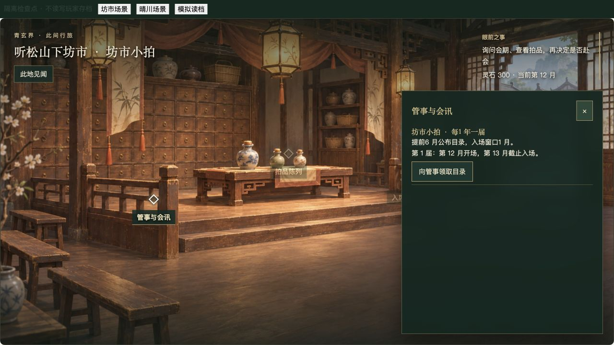
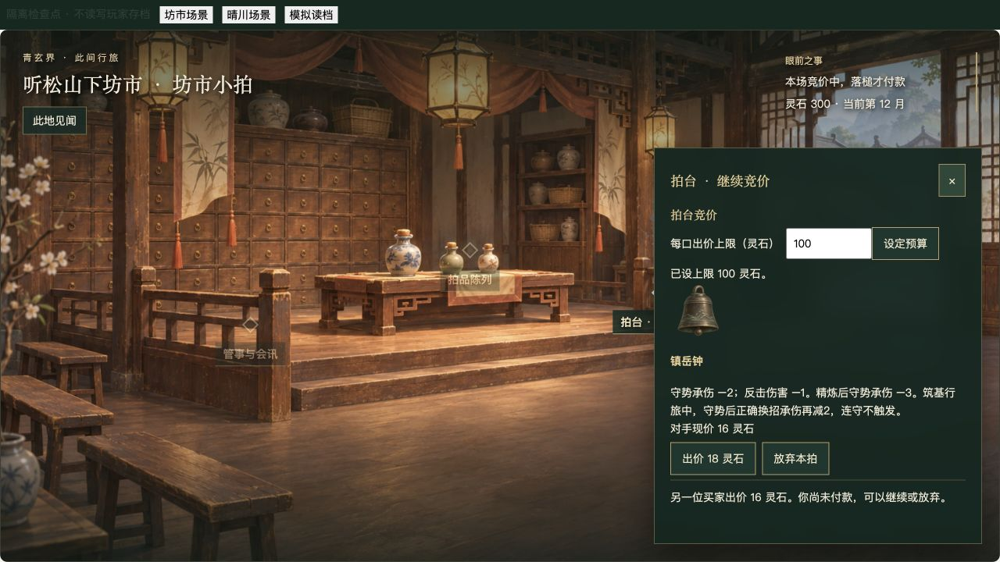
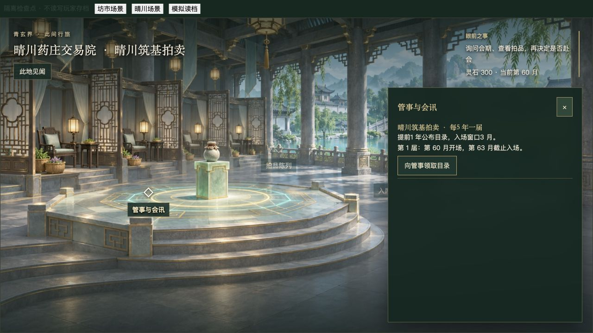

# 拍卖场景接入与验收

2026-11-05。本地接入，未提交、未推送、未发布。设计见 [场所与会期拍卖](../auction-design.md)。保留本轮开始前已有的其他系统改动，不将工作区全部变化归为本轮。

## 已接入

- 独立 `src/auction`：会场配置、拍品目录、随机生成、会期、竞价、交付调用、会次校验与只读展示。旧 treasure 命令转发，随身宝物去掉远程参拍按钮，仅保留已知会讯。
- 听松山下坊市小拍：每12月一届，提前6月公告，入场窗口1月；RoadPanel 当地“坊市拍卖行”对象进入。
- 晴川药庄交易院筑基拍卖：每60月一届，提前12月公告，入场窗口3月；FoundationPanel 当地交易院对象进入，前往晴川沿已有内陆旅行路线。两处各有独立生成的1920×1080背景，非同图换色。
- 地点、境界、会期与活动互斥在命令层执行，旧坊市 stage 不能在远方授权参拍。入席为0月，路程由旅行结算；本地候会按月推进并承接剧情/寿尽中断。
- 本届目录、起价、竞争者预算、竞价与成交记录固定。不同会场保留各自目录，切换、关闭面板或读档不重抽。正式退出不能重入同届，下届才刷新；独特拍品有其他合适候选时避免连续重复。
- 已知会期在闭关/旅行报价中提示可能错过截止，不强制暂停普通修行。散场后管事展示下一届会期。
- v46保存与保守迁移：旧场散场，保留已成交与已拥有物品、不补奖励、不自动传送；未知档不覆盖。

## 自动检查

- 首次 `npm test`：1319项通过，3项长路线模拟因默认5秒/15秒超时失败；未出现断言失败。
- `npm test -- --maxWorkers=4`：1321项通过、1项 world 长路线模拟超时。
- `npm test -- --maxWorkers=1`：**193文件、1323项全部通过**，200.59秒；未修改原测试超时阈值。
- 全量之后收拢拍卖目录/校验实现，补损坏输入与散场下一届展示保护，并调整退出说明。最终对拍卖、宝物、保存迁移、闭关、旅行/UI执行针对性复核，结果见本记录末尾。
- 原宝物成交、满库存原子拒绝、固定种子、重复命令和保存测试继续沿用，只调整其到场与会期夹具。新测试覆盖地域限制、两地独立日程、开闭场边界、跨会场恢复、过期、下届换品、候会中断、迁移与已知会期提示。

## 实际浏览器证据

使用本目录 [隔离验收页](preview.html) 与 `tools/auction-checkpoint.ts`，不读取或写入玩家存档，**不属于正常新档连续试玩**。

实测应用内浏览器1280×720：

1. 从坊市场景“坊市拍卖行”对象进入，看到一年周期、半年公告和一月入场窗口。
2. 领取目录、设100灵石预算、入席，出价14后对手回应16。模拟序列化读档、收起操作再打开拍台，现价16/下一口18保持不变，月份仍12。
3. 首次浏览器路径继续以18、22出价，镇岳钟22灵石成交，余额300→278，进入回春散下一拍；该路径经历后续开发热更新，不声称冻结版本连续试玩。
4. 最终版本再次验证目录、预算、首轮出价、收起面板、读档恢复和正式退出；退出后显示本届不能重入，未成交不扣款。
5. 切换晴川隔离地点，从交易院热点进入不同石厅，显示五年周期、一年公告、三月窗口，并领取目录。晴川完整成交通过实际组件按钮测试，浏览器本轮只到目录。

美术原图、提示词与尺寸/缩略图QA由独立素材聊天交付，见 [美术记录](../art-candidates/auction-20261105/README.md)。原始图1672×941，导出1920×1080，不声称原生1080p。

## 未完成与边界

- 金丹10年、元婴30年与专门场所仅为设计，没有高阶虚假入口或假拍品。
- 本轮未做全世界统一玩家位置、自动跨地域会讯传播、玩家寄售、动态市场经济、会场人物逐帧演出。
- 本轮未完成新角色从开场自然抵达两地的连续试玩、长期经济平衡、1920×1080实际浏览器、Windows实机或Steam验收。
- 背景1920×1080素材尺寸不等同于1920×1080实机UI证据；仅本轮1280×720隔离场景截图可作为浏览器证据。

## 最终复核结果

- `npx vitest run tests/auction.test.ts tests/auction-ui.test.ts tests/treasures.test.ts tests/treasures-ui.test.ts tests/save.test.ts tests/migration.test.ts tests/retreat.test.ts tests/cultivation-outlook-ui.test.ts tests/story-travel.test.ts tests/wayfaring-ui.test.ts --maxWorkers=1`：**10文件、79项通过**。
- 最终 `npm run build`（含 vue-tsc）通过；Vite仍提示既有主包/renderer大于500kB，本轮未做打包拆分。
- `git diff --check` 通过。未执行提交或推送。

## 世界地图与旅行补接（2026-11-05）

- 世界图原有坊市、晴川药庄标记附上拍卖会名称，点击仍选中原地点。两座厅堂登记为当地子场所。
- 世界图详情、内陆旅行图及相关章节旅行图共用只读会讯投影；已知会期按真实行程预测入场，资格不满足时不输出抵达预测。
- 新增地图纯度、发现隐藏、原地点选中、陆路/御剑时间差与截止月回归。
- 本次相关 7 文件 42 项测试通过；`npm run build` 和 `git diff --check` 通过。构建仍有现有大分块提示。本次地图补接以规则和组件回归为证据，未追加正常新档浏览器赴会或 Windows/Steam 实测；前述场景截图不作为此次地图视觉验收。

## 赴会链路与目录交互补完（2026-11-05）

修复：已领取本届目录时，「展开本届目录」现在直接切换到陈列，不再被重复领取规则禁用，不提交命令、不重抽。目录标题标明届数，避免旧目录被误认作新一届。旅行图的拍卖名称改成地点下方副标题；行程距离、耗时与寿元先于会讯展示，入场说明按需展开，避免长标注溢出和嵌套滚动区域。

浏览器实际证据（1280×720，隔离 QA 页，不读写玩家存档）：

1. `auctionTravelFixture` 通过公共命令完成青嶂及无名渡行路资格，随后人为设置赴会用日历、出发地点、御剑与资金。这不是自然新档连续试玩。
2. 第 478 月从听松行前居赴晴川。切换陆路显示 7200 里、6 月、预计第 484 月到达，将错过第 483 月截止；切回御剑显示 5100 里、2 月、第 480 月抵达仍可入场。
3. 点击动身，公共旅行命令结算后进入晴川药庄，再通过「晴川交易院 · 拍卖行」现场热点进入会场。重复展开第 8 届既有目录成功。
4. 设预算 100，依次出价 20/24/28/32，照隙镜以 32 灵石成交；余额 300 → 268，日历仍为第 480 月。点击模拟读档，成交、余额和其余拍品保留。

截图：[御剑赴会地图](travel-flight-1280.png)、[抵达后竞得与读档](travel-auction-won-1280.png)。相关 10 文件 56 项测试通过，包含真实旅行命令下陆路错过/御剑入场及重复展开目录无状态变化；构建及差异检查通过。未覆盖新档自然全流程、1920 分辨率或 Windows/Steam，本轮没有提交或推送。

## 金丹沧澜会馆（2026-11-05）

### 实施

- 古渡商盟泊船问询 → 已知世界图地点与会讯 → 12,000里/两月航路 → 会馆泊岸 → 拍卖厅 → 候会/竞价 → 两月返渡。十年周期、提前两年公告、半年入场窗口。会馆使用独立海景背景，见 [素材与原图](../art-candidates/auction-golden-20261105/README.md)。
- 来信复用已接入的 correspondence：知情后公告期投递，每届去重；目录仍需现场领取，消息不抽签。关注会讯的行程计算使用真实两月航路。
- 三拍支持温养材料、养神丹、药材与研修札。实际库存/心得交付与上限校验，不出售剧情法宝或突破核心材料；本批并未新增完整金丹法宝/功法。
- 当前 v49 为共享迁移边界，增加金丹会讯知情与空会场档案；已有低阶活动会次、种子、年月、付款记录均保留。不回填新会讯或传送地点。

### 真实浏览器与范围

1280×720 独立验证页 `golden-preview.html`，通过 `useStoryTravel` 和正式组件/命令操作。角色前期由公共命令检查点获得，随后调整会前日历与资金，属于隔离场景验证，不是正常新档连续试玩。因共享编辑触发热更新重置，最终在禁用热更新的独立5277端口重新完整操作，不触及玩家存档。

- 第1556月，在古渡点击商盟泊船并打听会讯；看到第13届1560月开场、1566月截止，以及两个月航程。
- 第1558月抵达会馆，现场领取目录；候会两月至1560月，设置预算100并入席。
- 温养灵材匣48灵石落槌：灵石488→440、灵草1→13、玄铁0→4，竞价不改月份。模拟读档后结果保持。
- 正式退出、回泊岸、预览返渡并动身；第1562月回到古渡，所得资源保持。
- [成交与读档截图](golden-won-1280.png)。素材1920×1080已检查，但本次未做1920实际浏览器、Windows或Steam验收。截图拍摄后仅调整了拍品说明用语及养神丹估价（与炉房48灵石一致），未改变已验证灵材成交流程。

### 自动验证

首轮全量201文件：1363通过、1失败；失败为既有地图全地点样例没有设置新会馆知情标记。补充该样例后，最终相关9文件79项全通过，覆盖新地点发现/往返/会期、拍品真实交付、心得满额拒绝、余程读档、旧活动拍卖迁移和修复的地图用例。最终构建与差异检查通过，仍有既有大分块警告。本轮未再次跑完整套件，不能将首轮计数改写为全量全绿。未提交、未推送。

## 2026-11-05 后续三项：正常筹资、拍品用途与会期边界

新增 `tests/golden-auction-journey.test.ts`：从 `outerSeaCheckpoint()` 原样开始，不追加灵石、不修改月份、年龄、境界、拍品或奖励。其此前进度由公开命令生成，属于确定性成长路线，**不是从建角开始的真人连续试玩**。每条命令经过状态校验、确定性重放以及保存/迁移。

- 起点第1457月、灵石50、心得4。劳作筹资、航行、古渡问讯、会前领目录；未入席时返回古渡与山中，劳作后再赴会，本届目录不变。
- 第13届第1560月开场，材料匣48、养神丹44、药材匣22灵石成交，共114。会馆估价分别56、48、36。十年一届是可选补给机会，普通获取路径仍保留；这条固定路线不能证明总体经济平衡。
- 养神丹实际服用后减少库存并增加神识；灵草接续观潮、外府/内府争宝和首次温养，最终通过公开命令续炼镇潮印，扣除4灵草并保存强化结果。拍卖没有替代秘境资格或直接授予法宝。
- 另以受控拍品覆盖研修札：成交所得心得达到2后，另备灵草与灵石，功法研修等级实际提升。现有心得是永久资格，不因研修消耗；修正“先研修消化后再竞拍”的错误提示。正常起点心得已满，因此不会抽到这类拍品。
- 复制正常路线分支，修行并用普通行动越过截止月，拒绝入席且保留原目录；继续到下届公告期生成新届目录。航程中断读档的余月校验沿用原 `golden-auction.test.ts` 受控存档测试，不将其写成自然事件或浏览器实测。

浏览器检查使用 `golden-preview.html?normal`：原样公开命令成长档；页面顶部两个劳作/修行按钮只发送普通命令，未读写玩家存档。以鼠标操作劳作、出海、问讯、赴会、领取目录、设预算、候会、三件竞价和保存迁移检查。第1549月提前抵达时入席禁用，候会11月至1560月才开放；三件共扣114灵石，余额398→284、灵草1→31、玄铁0→4，读档后保持。截图见 [正常资金竞拍与读档](golden-normal-won-1280.png)。药物服用、功法研修和法宝续炼本轮以命令回归证明，未逐项浏览器实测。

本轮未调整十年周期和物价：先保留可选补给定位。新档完整人工试玩、更多种子/构筑的经济体验、自然事件打断航程与Windows/Steam验收仍未完成。

本轮最终验证：`npm test -- --maxWorkers=1` **204文件、1377项通过**；`npm run build` 通过（保留已有大分包提示）；`git diff --check` 通过。首次构建曾遇到并行修改中的 `world-revisits.test.ts` 类型错误，未覆盖他人文件；后续当前工作区构建已通过。上述结果对应本轮共享工作区快照，不代表发布或Windows实机验收。未提交、未推送。
