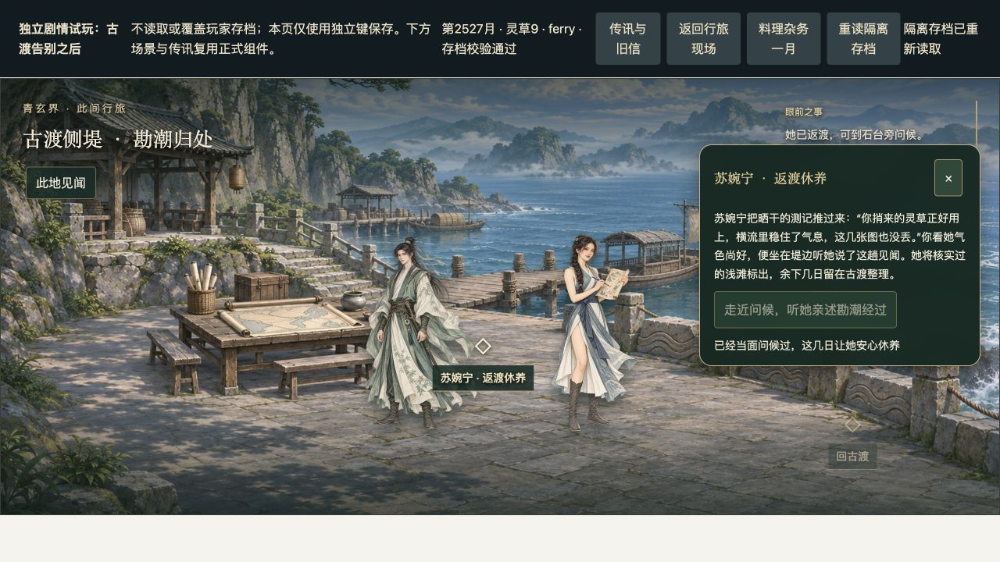

# 勘潮通信实际浏览器试玩 · 2026-11-05

## 环境与边界

在Codex内置浏览器实际点击，1280×720。入口`docs/friend-journey-review/play.html`，独立localStorage键`xxrs-isolated-friend-play-v1`，不读取或覆盖主游戏存档。初始检查点通过goldenLateCheckpoint和公开重逢命令构造到第2510月告别之后；此后全部由页面按钮调用公共命令，没有脚本改月、改位置或补事实。

复用正式CorrespondencePanel、OuterSeaPanel、FriendJourneyScene。页头杂务一月/重读按钮是隔离测试外壳，导航回调只覆盖本次外海现场，不等于App全部导航、存档槽和旅行演出验收。不是正常新档连续成长或Windows/Steam验收。

## 实际路径

1. 2510→2511→2512月：点击两次杂务。首月尚无来信，次月出现未读整备信。展开后未读少1、已读多1。
2. 写信与联络寄灵草2：11→9，当月不推进；侧堤仅旧信路线索，无苏婉宁人物。
3. 古渡归山海路，正式回山命令耗6月，到2518月home。途中出行传闻2515月送达。
4. 三次杂务到2521月，收到返渡传闻。消息组逐封阅读，传闻不能直接核验。
5. 在此修复读信引导后，旧信显示回古渡单程6月、预计赶得上休养；点击查看古渡去路，选外海航路，正式乘舟到2527月ferry。
6. 古渡“侧堤·苏婉宁返渡”→返渡休养→走近问候。对白正确提及所寄灵草与保住测记；已探望禁用重复，年月不变、灵草仍9。
7. 点击重读隔离档，探望结果保留。已核验的休养信仍保持未读，未被探望代读。
8. 三次杂务到2530月：侧堤人物消失，只留回药路静修去向；完成信2530月送达。共5封此事往来，全部逐封读完。
9. 整页刷新后仍2530月、灵草9、5封已读、校验通过。打开旧信显示休养结束，不再催赶古渡。浏览器error日志空。

## 体验中发现并修复

- 组标题固定采用首封“准备再勘潮路”，归来后误导：改为稳定“苏婉宁的勘潮行程”。
- 首信相对“三月后”忽略送递耗时：新信改为明确出发月，已保存旧信不重写。
- 归来信只有“查看人物”：新旧friend信统一“查看古渡去路”；messageLead复用seaQuote显示实际6月/商盟2月航程，并按当前已得知事实和预计到达提示可赶上/会错过/已离开。消息不传送玩家。
- 默认交谈浮窗挡人物脸、底部文字截断：仅本场景桌面面板移至右侧，内容高度调整。实际截图确认两人可见且完整显示“已经当面问候过”。

## 自动验证与未覆盖

相关5文件33项通过，包含新去路边界测试；npm run build及git diff --check通过，构建保留既有大包警告。本轮未重跑全量，不把此前共享全量失败记为本次已消除。

实际走了寄药且赶上探望分支。未寄药、迟到、临界寿元、结契冲突及远程拒绝等仍以既有规则/组件测试为证据，未重复真人操作。当前仍为静态角色立绘和短交谈，无完整走近/坐下/递图动画。现场“坐在石台旁”的文本与站姿素材仍有表现差距，留作后续演出工作，不能称逐帧沉浸演出完成。
