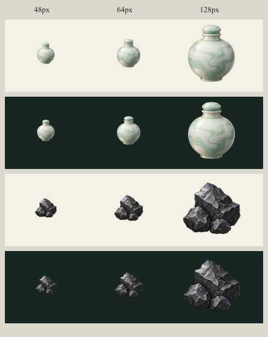

# 护脉丹与玄铁料图标交付

日期：2026-11-02。依据 `AGENTS.md` 与 `docs/art-direction.md`，使用 imagegen 技能及内置 `image_gen` 工具独立生成。素材已制作，尚未接入界面。本次仅新增 `public/art/workshop/` 与本目录文件，未修改 src、tests、规则或现有文件，未提交 Git。

## 运行时素材

| 对象 | 文件（仓库相对路径） | 尺寸 | 文件大小 | 内容 |
| --- | --- | --- | --- | --- |
| 护脉丹 | `public/art/workshop/meridian-pill.webp` | 256 × 256 | 12,998 字节 | 青白圆腹中国瓷丹瓶，瓷塞、温润釉面与浅青流纹；没有裸药片 |
| 玄铁料 | `public/art/workshop/spirit-iron.webp` | 256 × 256 | 22,176 字节 | 三块相接黑灰矿铁，灰银断面与克制金属纹理 |

两张均有真实 alpha 透明通道，外缘像素 alpha 全部为 0。导出采用 Sharp 等比缩小与 WebP quality=90、alphaQuality=100；没有手动抠图、重绘或修改生成内容。保留生成的透明度。

## 原图与提示词

- `originals/meridian-pill.png`：1254 × 1254，生成原图。
- `originals/spirit-iron.png`：1254 × 1254，生成原图。
- [prompts.md](prompts.md)：两次完整提示词，均请求透明背景，无参考图片。
- [qa/metadata.json](qa/metadata.json)：原图和运行时文件元数据、字节数、透明像素统计。

## 实际视觉 QA

已打开并人工检查 [qa/contact-sheet.png](qa/contact-sheet.png)，各列为真实 48、64、128px，分别置于浅米色 `#f5f0e5` 与深绿色 `#172622` 底色。预览由最终 WebP 解码后缩小，因此检查对象与运行时素材一致。六张透明尺寸样图同时保存在 `qa/`。

- 48px：丹瓶圆腹、短颈与瓶塞可辨；矿铁仍有一大两小的紧凑轮廓。丹瓶釉面细纹有所损失，但不影响类别识别。
- 64px：丹瓶青白材质和矿铁断面层次可辨，二者无需依赖名称即可区分类别。
- 128px：釉面流纹、矿铁粗糙金属断面均清晰；无文字、水印、装饰边框或新增品质标记。
- 深色底：玄铁暗部对比弱于浅色底，但灰银受光面及外轮廓仍可辨。没有添加发光描边或额外光效。
- 浅色底：瓷瓶较浅，底部及侧面的青灰阴影维持轮廓。未发现实体黑底、方框或明显裁切。

验收范围仅为素材与离线尺寸预览，不代表已经接入游戏或完成真实设备验收。本任务不涉及代码，也未运行 npm test / npm run build；未提交 Git。文档使用 `git diff --no-index --check /dev/null <文件>` 检查新增 Markdown 空白问题。

## 主会话接入补记

同日已由制作系统主会话接入 `src/presentation/art.ts`，供准备界面与储物袋使用。390px 实际浏览器加载无缺图；规则与界面验证见 [制作系统验收](../workshop-review/README.md)。上文“尚未接入”描述素材会话交付时点。
