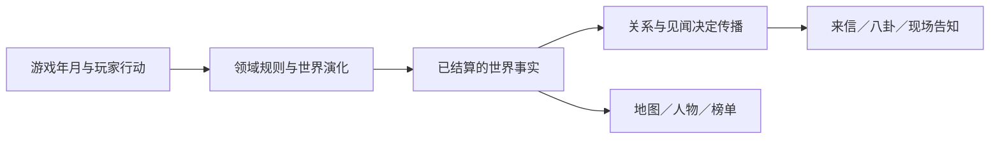

# 世界演化与消息传播

2026-11-05：已先接入事实投影与消息适配，再接入拍卖与人物里程碑的确定性日程首批。当前是现有规则的统一调度与跨月投递，不是全面随机 NPC 与势力模拟；周期遗迹首批见末节。最新接口见下节，后文未实施设计须按标注区分。

## 日程首批实际接入（2026-11-05）

`src/world-evolution/index.ts` 公开：

- `worldTransitions(state, until)`：返回 `(state.month, until]` 的结构化日程事实，按年月、稳定 ID 排序。拍卖包含预告/开场/截止，人物包含路图/筹备/失利/恢复/凝丹/近况未知。返回结果不包含消息文案、已读或资源奖励。
- `nextWorldBoundary(state)`：读取下一个世界月界点，当前拍卖周期最长120月，因此只需查询未来120月。它是世界日程，不自动作为闭关中断条件，也不直接向玩家暴露未知地区。
- `settleWorldMonth(before, after)`：根据实际完成的年月范围返回事件，支持月结算和已完成的跨月行动。无耗时或新人物人生返回空，不按照请求耗时猜测结果；这是纯结果计算，不修改输入。

`golden-story/companion.ts` 的 `companionMilestone` 统一人物阶段判定，`companionNews` 与日程适配器复用；`companionChronology` 保留原独立经历和已核验旧记录兼容规则。没有按玩家境界自动升级，也没有改凝丹年月或突破门槛。

`correspondence/calendar.ts` 是单独的传播 Adapter。已知拍卖来源只投递预告，不为开场/截止额外刷信；人物沿已有金丹与联络资格投递。稳定消息 ID 与原 sources 共用，故月回调和命令尾部重复检查不会重复发信。未读逐封保留。信件使用跨越边界的游戏月作为送达年月；当前已知信路不另加运输延迟，未来若设计延迟须另建规则，不能混淆人物事件发生与送达时间。

接线在 `world.ts` 的 `normalize` 完成所有领域恢复之后，以及公共 dispatch 尾部。前者覆盖现有月推进回调，后者兜底其他实际耗时命令；两处共享同一日程模块，不复制算法。只扫描本次实际跨越区间，不在读档时追补旧年月。零耗时状态变化仍由原 `deliverMessages` 读取现况。

保存策略：本批事实可从既有会期配置、人物经历与年月确定推导，已送达状态复用现有 Letter ID 与 received；不新增持久字段，不升级当前存档版本。日期约束、保守迁移和未知版本保护不变。此策略不适用于未来需要随机抽选、竞争胜负或独立 NPC 资源扣除的模拟，那类变化必须另做持久事实与迁移。

测试：`tests/world-evolution.test.ts` 验证半开区间、同月稳定顺序、整段/逐月事实相等、未知来源不泄露、失利恢复凝丹不自动核验、重复投递幂等，以及真实公共 work 推进跨会讯、每月读档继续后会讯一致。首批4项通过，相关原专项11文件68项通过。完整验证补记见传讯实施记录。

## 三层职责

世界演化回答“事情是否发生、何时发生、造成什么变化”。事实层回答“已确定的结果是什么”。传播层回答“玩家从谁那里、什么时候、以何种可信程度得知”。读信和 UI 渲染不得反向触发突破、开奖、刷新拍品或推进世界。

现有拍卖由 auction 决定会期与成交；人物里程碑由 companionChronology 与对应剧情核验决定；外海遗迹由 outer-sea 结算。不能为写八卦绕过这些规则。玩家未收到消息不代表世界没有发生，听说传闻也不代表事实已被核实。

## 当前已经接入的 Interface

`src/world-events/index.ts`：`knownWorldFacts(state): WorldFact[]`。

这是只读快照，不是事件调度器。当前三种事实：已参与且散场的拍卖实际成交清单、已商议的外海遗迹当前里程碑、实际取得的筑基榜战绩。它不引用传讯结构、不随机、不创建人物成长，不重建缺失的中间历史。传讯 `events.ts` 使用 `reportWorldFact` 生成书信，同一事实使用稳定 ID；未来地图/人物可读取同一事实接口。

这个接口仅覆盖本轮三种事件，并未强行搬迁所有旧消息。拍卖预告、主线邀约、可靠人物来信仍沿原适配器；后续根据实际需求迁移。`WorldFact` 不包含已读、关注、收件年月等消息字段。当前 id 是事件语义标识，**没有可靠的发生时间字段**，不得把发信或读信时间冒充事件发生时间。

## 后续世界演化扩展（历史方案与未实施部分）

最初建议如下；当前实际接口以上节为准，尚未增加随机状态写入：

- `nextWorldBoundary(state)`：下一个有意义的游戏月界点，供 timeline 预估和批量推进使用。
- `settleWorldMonth(state, month)`：在命令私有草稿上执行该月到期的变化，返回结构化事实；读取操作不得调用。

所有耗月入口共用现有 timeline 的月结算；不得额外建立 UI 定时器或另一个独立时钟。玩家零耗时行动导致的事实由所属领域即时结算，不应为了统一入口拖到下一月。

先接两种真实差异的 Adapter：拍卖会期、独立人物修行里程碑。具体功法条件、寿元、修行资源、失败恢复保留在人物领域，拍品与竞价保留在拍卖领域。调度器只掌握到期与稳定顺序，不把这些规则复制成巨型 switch。遗迹开放与势力变化等新增行为必须先有具体玩法与领域规则，不能只为了丰富消息而假装发生。

### 结算约束

1. 以游戏年月为唯一时间。现实离线不推进、不惩罚。
2. 同月采用固定阶段与稳定事件 ID 排序。资源扣除、突破条件、结果生成必须确定顺序；不依赖数组插入顺序或 UI 访问顺序。
3. 同样的存档种子与行动序列产生同样结果。随机只在实际结算时使用保存的种子，预览、读信、查看地图不得消费随机数。若引入独立世界种子，必须单独版本迁移，不能从系统时间生成。
4. 长闭关和逐月执行，除明确的玩家中途选择外应一致。先复用逐月结算保证正确，再按下一个边界跳跃优化；不能跳过途中的失败、恢复或生死事件。
5. 命令原子提交：世界状态、相关资源、事实结果、下一触发点一起保存。重复 command ID、重复结算月份均不产生第二次奖励或第二次事实。
6. 重要人物有自身目标和条件，但沿已有剧情承诺与可靠经历发展。苏婉宁不能按玩家境界自动升级；恋爱与结契不能被随机世界事件代替选择。
7. 未联络、失联、确认死亡是不同状态，消息丢失或长时间未见不能直接触发“已死亡”。主线必要入口要有恢复/替代路径，不能在玩家闭关时被静默永久关闭。

### 事实保存与传播

真正引入异步世界变化时，再设计持久事实：事件 ID、主体 ID、发生年月、结构化结果、可见性、依据，以及单独的投递/核验记录。事件时间和送达时间必须不同字段。语义键至少包括主体、事件种类、会次或阶段，不能用消息标题去重。

不要无限保存每月流水。保存重要结果与尚未投递的必要事实；可重复周期的普通消息按明确留存策略压缩，个人重要经历保留。当前 Letter 上限与存档校验不能被新模块绕过。新增字段必须升级版本、校验器、保守迁移和未知未来版本保护，不按旧角色年龄回算并补发几十年事件。

传播应区分：本人报信（有可靠联系）、公开公告（在已知区域/来源）、道友转述（标明传闻）、现场目击。一个事实可有多个传播渠道，但默认只投递一次有用消息；后续只有核验或实质新进展才新增，而不是每个 NPC 各发一份。重要邀请可以突出，普通闲谈不打断闭关；是否中断由已有日程政策决定，不由消息文案决定。

### 实施顺序与验收

1. 本轮：事实投影 + 消息 Adapter + 真实结果闭环（已接入，见传讯实施记录）。
2. 下一批：选拍卖会期与一个人物里程碑贯通月结算，先做行为等价提炼；不同时扩写全世界。
3. 再增加一个有真实进入/关闭/恢复路径的遗迹周期，验证传播、行动、结果和旧信现况。
4. 之后才考虑更多人物、势力与竞争。避免现在引入通用脚本语言、全局消息总线或大规模逐 NPC 每月扫描。

必要测试：跨月边界、长短推进一致、同月顺序、固定种子重放、读档继续、重复命令幂等、传播前后的信息隔离、批量跳时不漏关键事件、已结束机缘不再显示待领取。性能测试分别测普通月和到期集中月，不把 UI 帧率或真人体验等同于规则测试通过。

## 周期性遗迹首批（2026-11-05 已接入）

`tide-survey` 为旧府完成后的可选侧廊，周期120月、预告12月、开放12月；日程新增 tide 结构化事件。只在已有通关见闻之后送达，不预显未经历秘境。实际回古渡后按统一报价出发，余量不足不得进入，错过可候下一期。

这批增加真实持久化的一期一次探查记录，存档升至50。主线旧府不刷新，奖励不是传讯触发，事件和世界月推进仍确定可重放。成本、收获、风险和未实施的逐段演出详见 [潮隙实施记录](tide-survey-review/README.md)。它不意味着随机 NPC、势力事件或所有遗迹周期已完成。

## 持久人物行程首批（2026-11-05）

已接入苏婉宁告别后的单次独立勘潮，真实发生、晚一月传播、玩家核验分字段存入v52。准备/出行/返航/休养/完成五阶段，有出发前寄药的真实成本与结果差异。调用方只使用friend-journey的结算、报价与核验接口，不通过读信触发成长。详细规则、接手与未实施地图演出见 [实施记录](friend-journey-review/README.md)。本节覆盖前文“尚无持久人物事实”的历史描述，但不代表通用随机世界模拟已完成。

2026-11-05 第二批已将独立行程接至古渡侧堤：事实驱动人物在场，明确探望命令写入亲眼见闻，日期与邮路传播分离；结契约见复用人物可到场判断。v53保存探望月，详细边界见friend-journey-review/README.md第二批。
