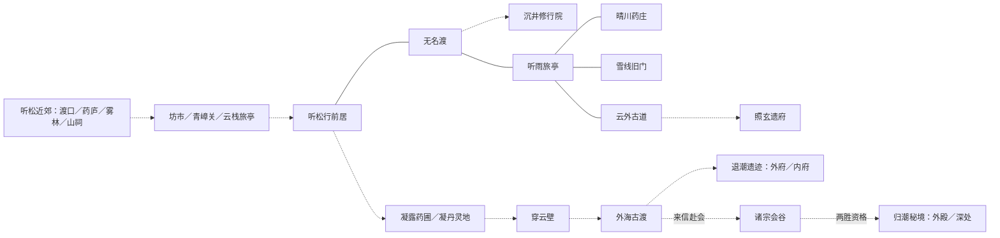

# 青玄界地理、旅行与御剑

2026-11-05 拍卖场所接入：听松山下坊市小拍与晴川药庄交易院筑基拍卖使用现有当地位置和真实旅行路线；进入当地会场不另扣旅行月数，会期与出发前提示见 [拍卖设计](auction-design.md)。金丹独立沧澜会馆已接入古渡两月航路；元婴专场仍未开放。

2026-11-03。本轮用户授权完善设计并开始实施，随后要求先核对最新剧情、预先规划地点距离与耗时，并抽取可复用移动表现。本文区分新地理设计、已存在剧情与本批实现；不从旧世界插画坐标推算里程。

## 依据与地图尺度

以 `mainline.md`、`foundation-growth-design.md`、`narrative/07-shen-mainline.md`、`narrative/08-secret-pact.md`、`golden-core-design.md`，以及凝丹、外海、诸宗会最新实施记录交叉核对。旧文中“金丹未开放”不覆盖后续已实施章节。

青玄界是一片连续世界。听松是西部起点，内陆药路向东展开，雪线在内陆北侧，晴川在南侧，古道向东通向更大地域，外海在东侧。这些方位是本轮新定的地图设计，不声称旧剧情已经给出测绘坐标。图上缩放随活动范围改变，旧地点不消失；境界决定通行能力，不凭空搬动地域。

采用三级尺度：地点现场（药炉、人物、房门）→地区路线图→青玄界概览。地区内点击目的地自动沿路行进，经过途经点不自动触发该地剧情。只有正式抵达才进入现场。已知地点、已通路线、曾经亲历分别展示，不把浏览地图记作到访。

## 剧情地理账本

| 区域 | 地点与归属 | 已有剧情约束 |
| --- | --- | --- |
| 听松近郊 | 雨夜渡口、药庐、雾林、废弃山祠 | 开篇营救属于一次短途；不额外扣月 |
| 听松药路 | 山下坊市、山口行营、青嶂关、云栈旅亭 | 沿既有开路与记录归路推进，不让飞行跳过关阵与共同开路 |
| 炼气历练 | 药谷淬脉泉、青石遗府及凝元内府 | 准备路线与秘境考验保留；内府不是独立城镇 |
| 雾岭/雾海旧路 | 营地、旧药圃、废驿、回声阵与灯室 | 属于旧路剧情，不能与金丹退潮遗迹合并 |
| 筑基内陆 | 听松行前居、无名渡、晴川药庄、雪线旧门、听雨旅亭、云外古道 | 相识→无名渡传承→三路择一→归途分歧→分别重逢→古道接应→归山 |
| 无名渡内部 | 沉井修行院与离渡通路 | 飞行不能跳过传承、离渡执卫与渡客处置 |
| 古道支脉 | 照玄遗府 | 三地任一路取材后均可赴约；途经古道不授予古道取材成果。按实际起点走支脉，不强制重做古道取材 |
| 凝丹筹备 | 凝露药圃、听松内比、凝丹灵地 | 内比与秘境是主药替代来源；不能把它们串成全必做路线 |
| 金丹初行 | 穿云壁、外海古渡 | 穿云壁承接突破后的能力兑现；古渡不是无名渡 |
| 外海 | 退潮遗迹外府/内府 | 潮汐、准备、实战与撤退成本保留，不用御剑跨过守卫 |
| 诸宗会 | 会谷、归潮秘境外殿/深处 | 古渡提前五十年告知，来信赴会，两胜取资格；不设永久比赛传送入口 |

云栈旅亭与听雨旅亭各占独立位置。昆仑雪域、太虚古墟、蓬莱仙境属于历史远景名称，未与雪线旧门或已开放外海强行画等号；本批新图不拿这些占位填充已可玩区域。

## 世界关系图

实线是本批内陆旅行路网；虚线是既有剧情衔接，尚未统一接入旅行图。图示不赋予通行资格。

## 距离与速度先行

里数为本作虚构地理单位，包含绕山、渡口接驳与必要歇脚。速度是整段旅程的综合效率，不是角色瞬时速度。

| 方式 | 综合行速 | 条件 |
| --- | --- | --- |
| 内陆陆路 | 1,200 里/月 | 使用已通地面路线 |
| 筑基御剑 | 3,600 里/月 | 学过起落，可试行；首次抵达掌握御剑术 |
| 金丹御剑回访内陆 | 7,200 里/月 | 已学御剑；外海有专门潮路，不自动套用此值 |
| 外海熟悉航路（规划标尺） | 9,000 里/月 | 对齐现有六个月航行，不代表开放自由飞渡 |

每次完整出行只对总距离取整一次：耗时 = 向上取整（路线总里程/该方式行速）。不逐条边取整相加。最少一月仅适用于跨地区长途；同城/近郊短途不套这个下限。空路较短来自绕山减少，但仍沿已知航点前进。境界提升不会自动给玩家教授御剑。

### 本批筑基主干（双向）

| 通路 | 陆路里数 | 空路里数 | 陆路耗时 | 筑基御剑 | 金丹御剑 |
| --- | ---: | ---: | ---: | ---: | ---: |
| 听松行前居—无名渡（经青嶂归路） | 3,600 | 2,400 | 3 月 | 1 月 | 1 月 |
| 无名渡—听雨旅亭 | 1,200 | 900 | 1 月 | 1 月 | 1 月 |
| 听雨旅亭—晴川药庄 | 2,400 | 1,800 | 2 月 | 1 月 | 1 月 |
| 听雨旅亭—雪线旧门 | 3,600 | 2,700 | 3 月 | 1 月 | 1 月 |
| 听雨旅亭—云外古道 | 3,600 | 2,400 | 3 月 | 1 月 | 1 月 |

听雨旅亭为本轮新增的地理路口定位，经过不要求入亭、不要求做阿团支线。路网经它组织各地，但玩家可直接选择最终目的地。

例：听松→雪线陆路 8,400 里/7 月，筑基空路 6,000 里/2 月，金丹同程 1 月。听松→晴川陆路 6 月、筑基御剑 2 月；听松→古道陆路 7 月、御剑 2 月。无名渡→晴川陆路 3 月、御剑 1 月。短边御剑仍一月，差异从跨地区整程体现，不能用 UI 假写更短。

### 其余区域的预先规划与实施边界

| 通路/行动 | 里程规划 | 时间归属 | 本批状态 |
| --- | --- | --- | --- |
| 开篇渡口—药庐—雾林—山祠 | 单段 5–30 里，属于近郊 | 不独立扣月 | 原规则保留，尚未接地图行进 |
| 坊市—行营—青嶂关—云栈旅亭 | 单段 30–120 里 | 近郊开路与行动已有成本，不按切图收费 | 原规则保留 |
| 药谷/青石遗府、雾海旧路 | 地区内单段 60–300 里 | 现有入境/准备/交锋包含探索时间，不再叠加大地图费用 | 本批未拆分既有命令 |
| 古道—照玄遗府 | 陆空均 80 里 | 并入整程里数只取整一次；抵达后的备阵与勘察另为 1 月 | 2026-11-04 已接地图与真实旅行 |
| 凝露药圃 | 从内陆路网延伸约 1,200 里 | 现有准备与进入分别保留，后续接图前拆清归属 | 只规划，不开任意起点传送 |
| 听松—穿云壁 | 约 7,200 里 | 现有金丹首次远行 1 月，包含试法与通过云壁 | 只规划，原命令保留 |
| 听松经穿云壁至外海古渡 | 完整航路约 54,000 里 | 熟路单程沿用现有 6 月；首次整备灵石 12 另列 | 本批不改航海命令 |
| 古渡—诸宗会谷 | 约 18,000 里潮路 | 沿用单程 2 月，包含接驳/赴会引路；非普通内陆御剑线 | 本批不改赴会命令 |
| 古渡—退潮遗迹 | 约 1,800 里近海 | 现有入境 2 月、撤退 1 月含候潮与探路，不能用距离覆盖 | 原规则保留 |
| 会谷—归潮秘境 | 同片海域内约 900 里 | 背潮 6 月/主流 2 月是风险与探索选择，不是纯移动速度 | 原规则保留 |

最后四类需等地图行进接入时核对出发位置模型，不用新里数改变现有外海、会期或秘境数值。高境界活动范围扩大到数万里，而旧内陆行程明显缩短；潮流与禁制防止飞行成为所有挑战的跳过键。

## 御剑与时间选择

行前居备有御剑札记，宗门和散修均可研习，不另加贡献或货币门槛。筑基后花一月练稳起落，再主动选择御剑完成一次真实行程，首次抵达记录掌握。不是只读一次文本即得全部旅行成果；不引入随机坠剑失败、强制刷熟练度或主修绑定。首次试行与后续飞行同速，避免以等待作为教学。

首批不改变战斗、修炼收益、补给价格。成本对照：旧筑基每次换地点固定 1 月，新版依路程 1–7 月；御剑 1–2 月（最长雪线↔听松 2 月）。以常见“听松→无名渡→晴川→听松→古道→听松”为例：旧 5 月；陆路 26 月；研习后飞行 1+1+2+2+2=8 月，另研习 1 月。合计九个月，占筑基总寿元 200 年的 0.375%；不能由此声称真人寿元压力已平衡。药庄/雪线/古道三条全主线须跑规则回归，看额外行路是否影响会期与资源恢复。

重要约定在出发前显示；逐月结算，到传讯停下，剩余路程入档。已耗时间不重复扣。继续只走余下路程；放弃回到最后安全出发处，已用年月不退且首批不另扣撤回时间，明确这是本批恢复机制，不称完整途中自由导航。寿尽/待决事件优先，未抵达不触发地点剧情与试飞完成。

## 工程边界与可复用表现

- `wayfaring/geography.ts`：地理归属、里程与速度配置；`routes.ts`：路径/距离计算；`rules.ts`：旅行资格、研习、逐月结算和中断；`state.ts`：存档与校验。
- 当前实际位置继续归属既有章节。首批不建立第二份可与章节矛盾的位置；旅行域仅保存能力和在途记录。后续统一全境界位置需独立迁移，不能宣称本批已经做到。
- `presentation/movement/path.ts` + `PathTraveler.vue`：纯路径几何和通用播放。输入点列、人物图、walk/flight、时长、进度与播放标志；无剧情、命令、资源或存档依赖。暂停、跳过、减弱动态、后台暂停、卸载清理在此统一处理。
- `TravelMap.vue`：旅行预览、方式选择、里程/耗时/年龄/余寿、已保存结果的演出。父组件继续走 dispatch→保存成功→更新 game。失败不开始演出、不显示抵达。动画结束仅收束表现，不触发结算。
- 新档 v32；v31 初始化未学习、无旅程，不补奖励和亲历。旧迁移链保留，未来/损坏档拒绝覆盖，首次保存保留原版备份。

## 分批范围

第一批：剧情地理账本与完整区域规划；筑基六地地图行进、距离耗时、御剑学习、金丹回访内陆提速与中断恢复。人物沿线与剑光表示移动，不称完整逐帧步态或全世界自由飞行。

后续：炼气近郊与青嶂路线衔接、凝丹/外海/赴会路径播放、全界统一位置与地图概览。每批都须保留剧情前置、同场脚点及已有费用归属；扩图不是在地图上提前开放未来元婴或跨界。

证据与未完成范围见 [实施记录](wayfaring-review/README.md)。

## 第二批落地补充（2026-11-03）

以上“首批/后续”是分批历史。第二批已接开篇、青嶂、雾海、炼气成长入境、凝丹道路、外海与会谷的已定义旅行行动，保留原命令费用，不重复收费。`passage.ts` 保存外海/赴会剩余月份，存档现为 v33；`story-routes.ts` 为只读章节路线适配，`RouteCanvas`/`PathTraveler`/`useMapFocus` 为复用表现。男性炼气/筑基八帧行走已复用，其他角色不宣称完整步态。地图是按剧情账本布局的路线示意，不是旧插画的等比例测绘。

详细行动覆盖、实际 App 与 PC 浏览器证据、Windows 测试包及未验收范围以 [第二批实施记录](wayfaring-review/README.md#第二批顺序实施2026-11-03) 为准。里程和耗时对照见 [旅行预算](wayfaring-review/travel-budget.md)。

## 2026-11-04 炼气、筑基剧情地图接入

此节覆盖上文照玄仅作章节切换的旧实现描述。新增地点来自 `narrative/10-existing-realms-revision.md`；具体结果见 `narrative-implementation/README.md`。

- 听松药坪沿用药庐安全据点，不切一次近景就扣月。石涧旧药窟在淬脉后开放，入窟含120里行路与勘路，共1月；青嶂支路含90里行路和布防，共1月，仅实际夺札引起追索时开放。撤回包含在原行程成本中，不另扣月。御剑不能跳过炼气药窟挑战。
- 照玄为云外古道80里支脉。晴川、雪线、古道任一路实际取材后可沿路网前往，不自动补古道战绩。跨地区旅行与府前准备拆开：路网收取完整行程时间，府前备阵/勘察1月；不再重复收费原先包含赴约的章节成本。
- 断碑驿在听雨旅亭与云外古道之间：旅亭至驿陆路1200/空路900里，驿至古道陆路2400/空路1500里；完整路线与原直达古道里数相等。原直达路径保留，旧存档路线不被改写；经过驿站不自动触发仇怨或算作抵达。
- 全图稳定显示新增地标与连线，当前地点、已经历和可前往分别投影。筑基地地区图可选择八个目的地，照玄/断碑必须满足剧情条件。离开支脉或驿站从实际位置计算，不能无偿跳回出发的药庄、雪线。
- 行程在来信时暂停，剩余月份、路线和起点保存在v38；读档续行不重复收费。观看、暂停、跳过行走/御剑演出不改时间和结果。

典型整程：雪线至照玄陆路7280里/7月、御剑5180里/2月；药庄至照玄陆路6080里/6月、御剑4280里/2月；古道至照玄单独出发为80里/1月，已包含于完整路线时不逐边重复取整。原六地距离和速度未变。

## 2026-11-04 离照与伏潮湾

外海古渡—离照泊岸每程36000里、6月，含潮路与候潮；实际使用统一passage与旅行图，途中事件保留余程，不重扣已走月份。离照外层、内层和旧丹室是同一洞天内部，不给局部走动另扣月；实战、药理验证与补药各有明确时间报价。伏潮湾属离照附近条件节点，只由强抢药份的真实纠纷开启，不劫持无争议路线。元婴首次护渡在古渡近旁潮隙，不偷渡尚未开放的回星墟长途。范围与验证见[完整金丹记录](golden-completion/README.md)。

### 地图同步复核（2026-11-04）

金丹后续地图补漏：地域说明加入离照、伏潮湾及古渡近岸设施；晋升元婴后保留已知的诸宗会谷/归潮秘境地标，但不据此开放重访。离照泊岸可从全图的外海古渡节点选取真实返航命令，沿用六个月整程与余程恢复，返航提示不再误写赴离照。伏潮湾提示改为当地消息，不向玩家解释剧情触发实现。

古渡旧静室、近岸试雷台与潮隙属于古渡附近活动，不增加独立跨区行程，不叠加赶路费用。金丹核心机缘仍须从既有探索与历练取得，地图不提供付费绕过试炼。此轮为只读地图投影、入口与提示修复，无新存档字段或成本调整。地图/旅行专项3文件14项通过；未新增实际浏览器截图验收。

## 渐进发现与剧情接入（2026-11-04，覆盖提前展示全图的旧约定）

境界决定远行能力，实际见闻决定地图内容。未知地点不显示名称、图片与连线；已知但暂不能前往的地点保留条件说明；探访过的地点不因晋升而消失。世界地图、内陆旅行图、目的地列表和章节潮路预览共用 `wayfaring/discovery.ts` 的只读发现条件，真正出发仍由原命令与报价裁定。查看地图不推进时间、不增加奖励。

- 开场随实际走到药庐、雾林、山祠逐步显露；药窟随淬脉经历，青嶂支路随追索警讯显露。
- 筑基初知听松与无名渡；第一次抵达渡口，由渡边旧图与渡夫指点得知晴川、雪线、古道及听雨分岔。照玄随同行约定、取材后的线索或亲历显露；断碑驿随正式追索通知显露。
- 金丹先问远行方向再见外海古渡，在当地结识引路人才知退潮遗迹；收到会期消息显露会谷，赴会介绍后才见归潮秘境。
- 问法中的丹药话题附离照泊岸、候潮与避礁标记，显露离照；伏潮湾须实际听过拦舟警讯，幕后已起争议不等于玩家已知。
- 已知旧地与保存的经历在后续境界保留；静室、试雷台、潮隙不作为炼气时可读的地域介绍。未开放灵界不出现目的地。

本轮复用既有已保存事实，不引入第二份发现存档，也不追补玩家未曾经历的剧情。用例中的状态夹具仅验证投影边界，不充当正常新档试玩证据。

回归过程：首次全量174文件1237项中1232通过、5失败。实际发现开场已调查出的药庐去路被隐藏，已修复：基础章节的有效剧情去路仍可见。其余旧用例将全图预显当作预期，改为保留已知坐标、未知隐藏；键盘选择雪线用例先通过公共命令赴无名渡取得路图。开场、地标、键盘旅行和发现条件专项4文件30项通过。最终全量结果另记下方。

最终复验：2026-11-04 17:19:05启动，174文件 / 1237项全部通过（85.59秒）；`npm run build`含类型检查通过，保留既有大包警告；`git diff --check`通过。本轮未新增正常新档浏览器连续试玩或Windows/Steam证据，未提交推送。

### 2026-11-05 现实旅行演出

旅行路线图改为全视口。现实演出由统一 `wayfaring/playback.ts` 按路线里程和移动速度计算，4–18 秒内对数压缩；暂停/跳过不改变年月结算。算法、例值及实际界面检查见 [现场与旅行修复](scene2d-review/dialogue-travel-20261105/README.md)。

### 拍卖场所与赴会预览（2026-11-05）

山下坊市和晴川药庄的地图标记附带当地拍卖场所，沿用原地点的发现规则和旅行入口。两座拍卖厅作为 `worldStoryPlaces` 子场所登记，不添加独立长途道路。世界图详情、内陆旅行图与相关章节旅行图展示当地周期；已知会期结合真实剩余行程预估能否赶上入场。规则与边界见 [拍卖设计](auction-design.md)。

### 金丹沧澜会馆（2026-11-05）

古渡商盟泊船初次告知后，世界地图显示沧澜会馆与古渡的连接。位于古渡东北侧商盟海岛，属于外海贸易航路，不替代诸宗会谷。地图示意坐标79/18；章节海路使用同一地点ID `guild`。往返各12,000里、2月，包含商盟引航与候潮，不能用御剑直接折算。距离/月数集中在 `goldenAuctionRoute`，章节命令与旅行投影共用。途中事件保存余程，读档续航只结算未走的月份。会馆内进入拍卖厅与退出均为0月。

开场前两年可收到会讯，十年一届、半年截止。古渡问询不会随机生成目录，赴会行程结合已知会期提示抵达时能否入场。会馆地图节点允许沿原航路返回古渡，未经发现不显示节点。实际证据见 [金丹拍卖记录](auction-review/README.md#金丹沧澜会馆2026-11-05)。
